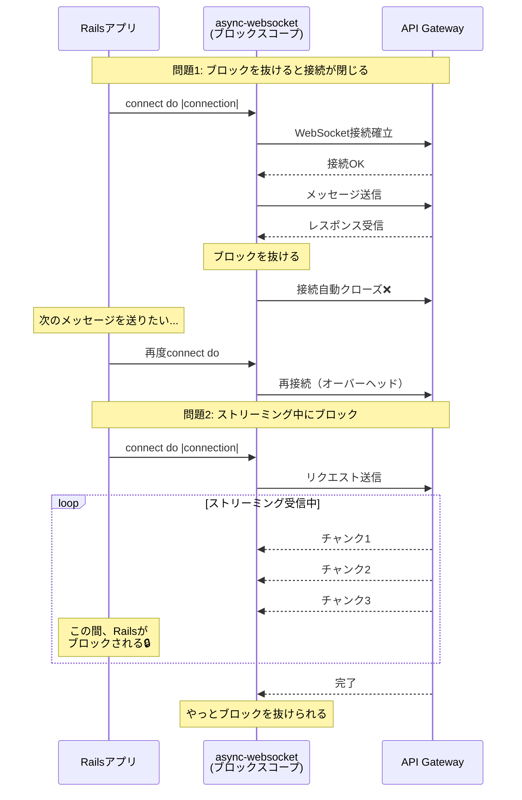
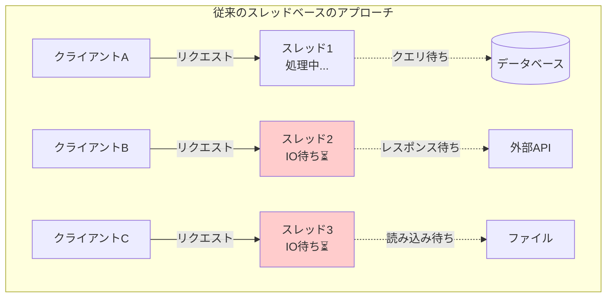
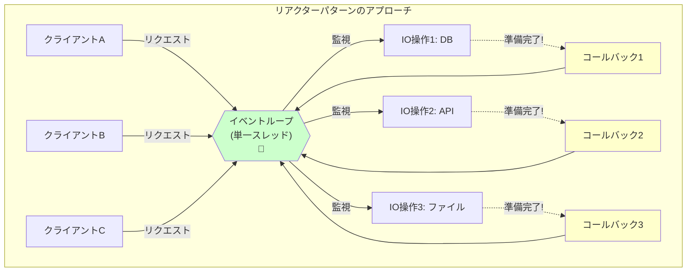
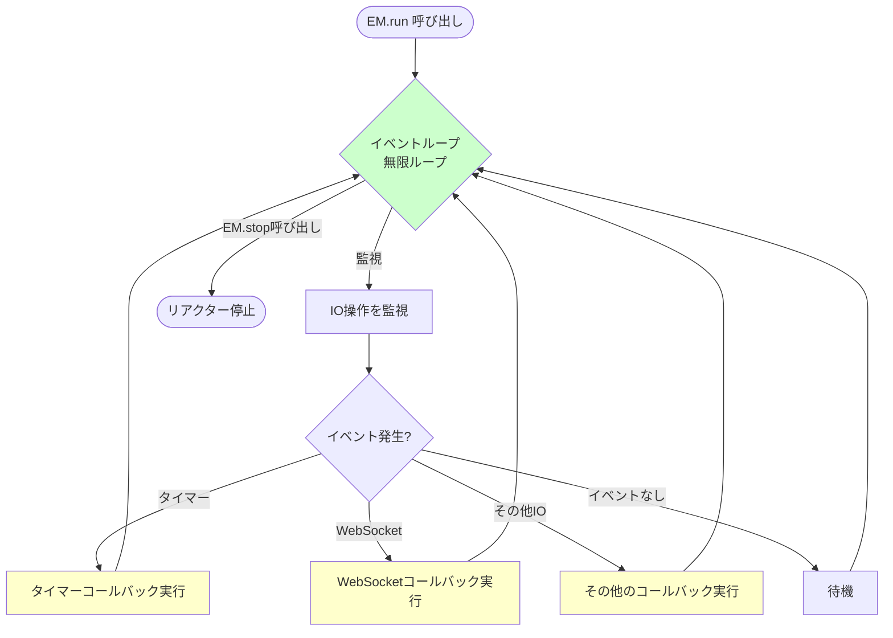
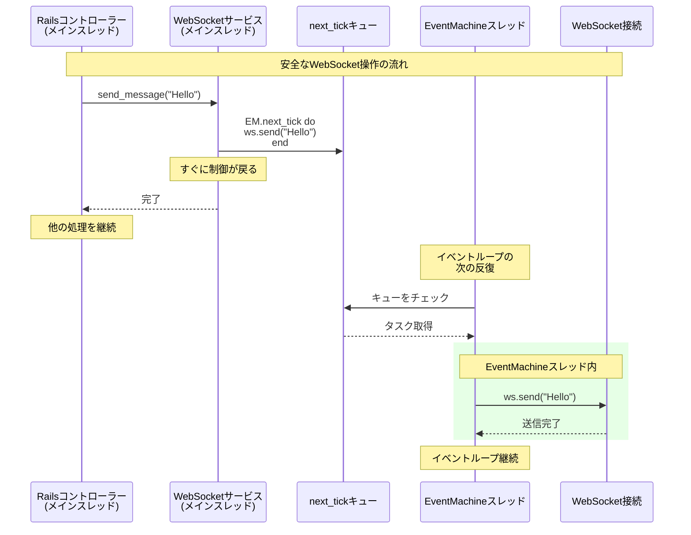
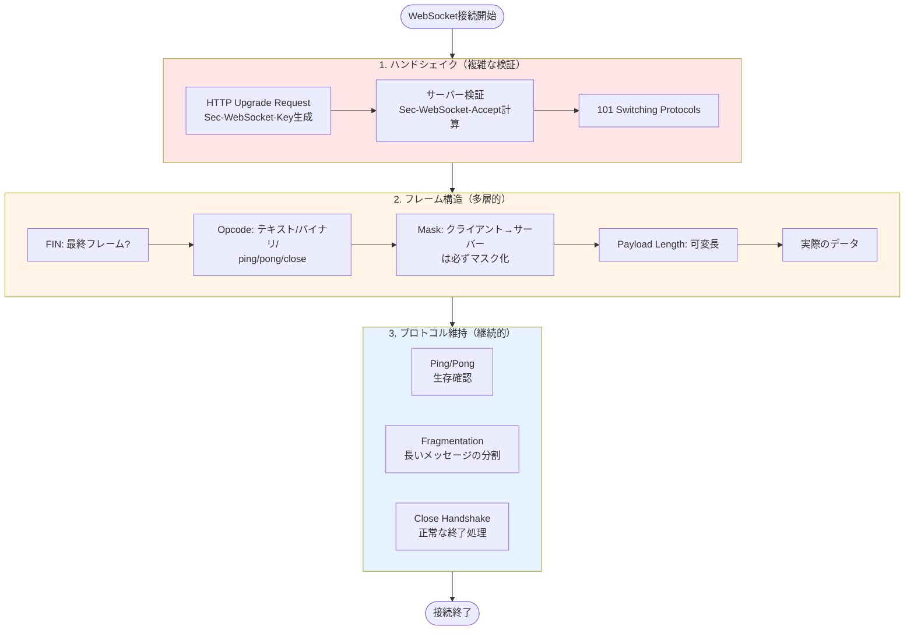
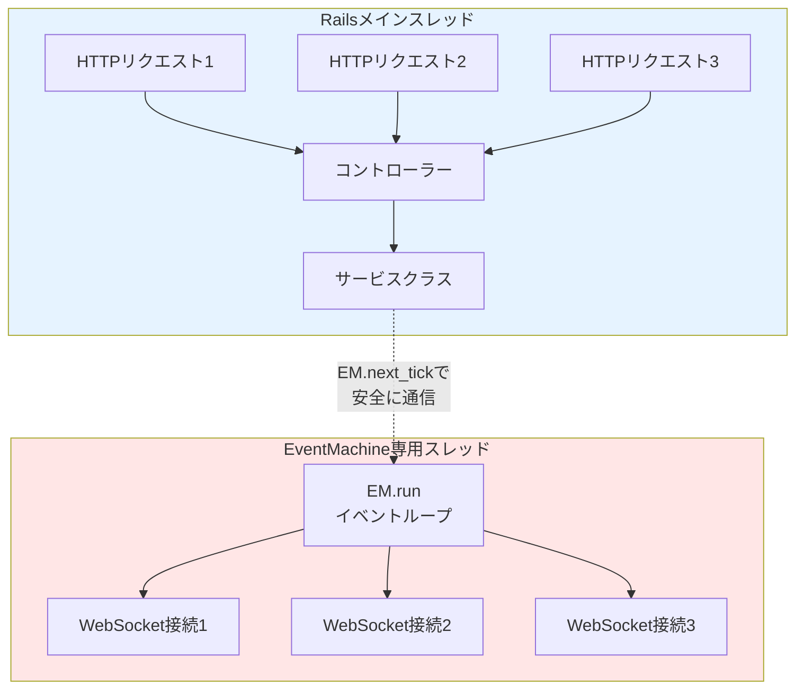
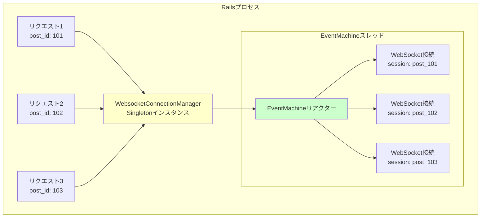

## はじめに

実務で、RAGを活用したAIチャットボットの開発を行う際に、RailsアプリケーションからAWS API Gateway Lambdaを介して双方向のストリーミング通信を実装する必要がありました。その際に、EventMachineとFaye WebSocketを組み合わせて実装することで、ストリーミング通信を実現することができたので、復習として学んだことをまとめていこうと思います。

## システム全体のアーキテクチャ

今回実装したAIチャットボットのシステムは以下のようなデータフローになっています。

```
フロントエンド (React)
    ↕ ActionCable (WebSocket)
Rails アプリケーション
    ↕ EventMachine + Faye WebSocket (WebSocketクライアント)
AWS API Gateway + Lambda
    ↕ HTTP
LLM API (Claude / OpenAI)
```

### 使用技術

- Next.js 15
- React 19
- Ruby on Rails 7.2
- ActionCable
- EventMachine
- Faye WebSocket

### なぜEventMachine + Faye WebSocketを選択したのか

WebSocketクライアントを実装する際に、`async`や`async-websocket`を検討しましたが、`async-websocket`はブロックスコープでリソース（WebSocket接続）を管理するため、今回の要件には適していませんでした。

[async-websocket]

```ruby
Async do
  endpoint = Async::HTTP::Endpoint.parse("wss://...")
  Async::WebSocket::Client.connect(endpoint) do |connection|
    # ブロック内で接続を使用
    connection.write(message)

    while message = connection.read
      puts message.inspect
    end

    # ブロックを抜けると自動的に接続がクローズされる
  end
end
```

`async-websocket`の具体的な問題点は以下になります。

- ブロックを抜けると接続が自動で閉じられる
  - connectメソッドのブロックを抜けると、自動的にWebSocket接続がクローズされます。そのため、接続を維持し続けるためには、ブロック内で無限ループを実装する必要がありました。

```ruby
# 問題のあるパターン
Async do
  Async::WebSocket::Client.connect(endpoint) do |connection|
    connection.write(message)
    response = connection.read
    # ここでブロックを抜けると接続が閉じられる
  end

  # 次のメッセージを送りたくても、もう接続は閉じている
end
```

- ストリーミングレスポンスの受信が困難
  - 今回のシステムでは、1つのメッセージ送信に対して、複数のストリーミングチャンクが時間をかけて返ってきます。そのため、`async-websocket`のブロック形式では、以下のような問題が発生します。

```ruby
Async do
  Async::WebSocket::Client.connect(endpoint) do |connection|
    connection.write(summary_request)

    # すべてのチャンクを受信するまでブロック内で待機
    while message = connection.read
      handle_chunk(message)
      # response_completeが来るまで待つ必要がある
    end

    # この間、Railsの他の処理がブロックされる
  end
end
```

- 上記のように、ブロック内でループして待機すると、長時間占有されてしまい、Railsのリクエスト処理に影響を与えてしまいます。

- API Gateway + Lambdaのアイドルタイムアウトへの対応
  - API Gateway側では、一定時間操作がない場合に接続を自動で切断します。そのため、今回は以下のようなシナリオが必要でした。

1. ユーザーが試験を受験する
2. 解答提出後、AIが総評を生成
3. ユーザーが追加質問する時は、既存のWebSocket接続を再利用して通信を行う

`async-websocket`のブロック形式では、総評生成後にブロックを抜けるしかなく、その時点で接続が閉じられてしまいます。そのため、追加の質問の際に毎回新しい接続を確立する必要があり、以下の問題が発生しました。

- 接続確立のオーバーヘッド : WebSocketハンドシェイクが毎回発生する。
- レスポンスタイムの悪化 : ユーザー体験が低下する。



### EventMachine + Faye WebSocket

EventMachineとFaye WebSocketは、上記の問題に対して異なるアプローチで対応することができました。

EventMachineは「リアクターパターン」というイベント駆動型のアーキテクチャを採用しており、接続を開いたまま、イベント（メッセージの受信、送信、接続の切断など）に対してコールバック関数を登録するという形で動作します。

これにより、接続を明示的に維持しながら、メッセージの送受信を非同期で処理することができます。<br/>
具体的には、接続を一度確立したら、その接続オブジェクトを保持し続け、必要に応じて何度でもメッセージを送信できます。レスポンスは、on(:message)コールバックで受け取るため、ストリーミングチャンクが複数回に分かれて届いても問題なく処理することができます。

```ruby
# EventMachineでは接続を保持し続けられる
ws = Faye::WebSocket::Client.new(url)

ws.on(:open) do
  # 接続確立後、この接続を維持し続けられる
end

ws.on(:message) do |event|
  # メッセージが届くたびにこのコールバックが呼ばれる
  # 接続は維持されたまま
end

# 後で別のメッセージを送信することも可能
ws.send(another_message)
```

実際の実装では、ユニークなIDごとにWebSocket接続を管理し、同じユーザーから複数のリクエストを一つの接続上で処理できるようにしています。これにより、接続確立のオーバヘッドを最小化し、API Gatewayのアイドルタイムアウト内で効率的にメッセージを送受信できるようになりました。

[GitHub Repository]

- [async](https://github.com/socketry/async)
- [async-websocket](https://github.com/socketry/async-websocket)
- [faye-websocket-ruby](https://github.com/faye/faye-websocket-ruby)

## EventMachineの基礎理解 - リアクターパターンと非同期IO

### リアクターパターンとは何か

まず、従来のスレッドベースのアプローチとリアクターパターンを比較してみます。

#### 従来のスレッドベースのアプローチ

従来のWebサーバーでは、リクエストごとにスレッドを割り当てます。クライアントAからのリクエストはスレッド1で処理され、クライアントBからのリクエストはスレッド2で処理されます。これは直感的で理解しやすいですが、各スレッドがIO待ち（データベースクエリ、外部APIコール、ファイル読み込みなど）をしている間、そのスレッドは何もできずに待機するだけになります。スレッドは比較的重いリソースなので、多数のスレッド作成するとメモリ使用量が膨大になります。



#### リアクターパターンのアプローチ

リアクターパターンは、単一のスレッドで複数のIO操作を同時に監視するという考え方です。具体的には、イベントループと呼ばれる無限ループが、すべてのソケットやファイルデスクリプタを監視し続けます。何かしらのIO操作が「準備完了」になったら、そのイベントに対するコールバック関数を実行します。



### EventMachineの動作原理

EventMachineは、このリアクターパターンをRubyで実装したライブラリです。中心となるのはリアクターと呼ばれるイベントループで、これは`EM.run`で起動されます。

```ruby
require 'eventmachine'

EM.run do
  # ここにイベント駆動のコードを書く

  # 例：1秒後に実行されるタイマーを設定
  EM.add_timer(1) do
    puts "1秒経過しました"
  end

  # 例：定期的に実行されるタイマー（2秒ごと）
  EM.add_periodic_timer(2) do
    puts "2秒ごとに実行されます"
  end
end
```



`EM.run`を呼ぶと、EventMachineのリアクターが起動し、そのスレッドは無限ループに入ります。このループの中で、EventMachineはすべての登録されたIO操作を監視し、何かイベントが発生したら対応するコールバックを呼び出します。`EM.stop`が呼ばれるまで、このループは継続します。

ここで重要なのは、EventMachineのリアクターはブロッキング操作だということです。<br />
`EM.run`を呼ぶと、そのスレッドは完全にEventMachineに制御を渡し、リアクターが終了するまで戻ってきません。これが、Railsのメインスレッドで`EM.run`を直接呼べない理由です。もし、メインスレッドで読んでしまうと、Rails全体がブロックされてしまい、他のHTTPリクエストを処理できなくなります。

そのため、実装では別スレッドでEventMachineを起動しています。

```ruby
@em_thread = Thread.new do
  EM.run
end

# リアクターが起動するまで待つ
sleep 0.1 until EM.reactor_running?
```

これにより、Railsのメインスレッドは通常のリクエスト処理を続けられる一方で、別スレッドではEventMachineが複数のWebSocket接続を効率的に管理できます。

### EM.next_tickの意味と重要性

EventMachineを使う上で理解が必要なのが、`EM.next_tick`の概念です。

EventMachineのリアクターは、イベントループの中で動作しています。このループは以下のような処理を繰り返しています。

1. すべてのIO操作をチェック
2. 準備完了のIO操作があれば、対応するコールバックを実行
3. 次のイベントループへ

ここで問題なのは、EventMachineのAPIを、EventMachineのイベントループの外から呼び出す場合です。例えば、Railsのコントローラーやサービスクラスから、WebSocketにメッセージを送信したいとします。

```ruby
# これは危険な例
def send_message_to_websocket(ws, message)
  # このコードはRailsのスレッドから呼ばれる
  ws.send(message)  # WebSocketはEventMachineスレッドで動いている
end
```

この場合、RailsのスレッドからEventMachineスレッドで管理されているWebSocketオブジェクトに対して操作を行おうとしています。これは、スレッドセーフ（複数のスレッドから同時にアクセスされても、正しく動作してデータの整合性が保たれる性質のこと）ではなく、競合状態を引き起こす可能性があります。

`EM.next_tick`は、この問題を解決します。これは「EventMachineのイベントループの次の反復で、この処理を実行してください」という指示を出すメソッドです。

```ruby
def send_message_to_websocket(ws, message)
  EM.next_tick do
    # このブロックはEventMachineスレッドで実行される
    ws.send(message)
  end
end
```

`EM.next_tick`を使うと、渡されたブロックはEventMachineの内部キューに追加され、次のイベントループの反復時にEventMachineスレッド上で実行されます。これにより、スレッド間の競合を避け、すべてのEventMachine関連の操作を適切なスレッドで行うことができます。

```ruby
# 接続を作成する時
EM.next_tick do
  ws = Faye::WebSocket::Client.new(url)
  # イベントハンドラの設定など
end

# メッセージを送信する時
EM.next_tick do
  ws.send(payload_json)
end

# 接続を閉じる時
EM.next_tick { ws.close }
```

これらはすべて、EventMachine外部のコード（Railsのサービスクラス）から、EventMachine内部のリソース（WebSocket接続）を安全に操作するための工夫です。



## Faye WebSocketの基本

### WebSocketプロトコルの複雑さ

WebSocketは、表面的にはシンプルに見えるプロトコルですが、実際には多くの複雑な処理が必要です。まず、WebSocket接続を確立するには、HTTPリクエストから始まる特殊な「アップグレード」プロセスが必要です。

クライアントは通常のHTTPリクエストを送りますが、特別なヘッダーを含めます。

```
GET /chat HTTP/1.1
Host: example.com
Upgrade: websocket
Connection: Upgrade
Sec-WebSocket-Key: dGhlIHNhbXBsZSBub25jZQ==
Sec-WebSocket-Version: 13
```

サーバーはこれに対して、101 Switching Protocolsというステータスコードで応答し、接続をHTTPからWebSocketプロトコルにアップグレードします。

```
HTTP/1.1 101 Switching Protocols
Upgrade: websocket
Connection: Upgrade
Sec-WebSocket-Accept: s3pPLMBiTxaQ9kYGzzhZRbK+xOo=
```

このSec-WebSocket-Acceptの値は、クライアントから送られたSec-WebSocket-Keyを特定のアルゴリズム（SHA-1ハッシュ化＋Base64エンコード）で変換したもので、正しいハンドシェイクが行われたことを検証するためのものです。

---

[ハンドシェイクとは]<br />
HTTPプロトコルからWebSocketプロトコルへ接続をアップグレードするための最初の手続きのことです。通常のHTTP通信とは異なり、一度確立すれば双方向の永続的な接続が可能になります。

---

接続が確立された後も、データはHTTPのようなプレーンテキストではなく、フレームという単位でやりとりされます。各フレームには以下のような情報が含まれます。

- FIN : 最終フレームかどうか
- オペコード : テキスト、バイナリ、ping/pong、closeなどの種類
- マスキング : クライアントからサーバーへのデータはマスクされる
- ペイロード : 実際のデータ

さらに、長いメッセージは複数のフレームに分割されることがあり（フラグメンテーション）、Ping/Pongフレームによる生存確認、Closeフレームによる正常な接続終了など、実装しなければならない細かい仕様が多数あります。



### Faye WebSocketが抽象化してくれること

Faye WebSocketは、これらの複雑な処理をすべて抽象化し、シンプルなAPIとして提供してくれます。そのため、開発者、WebSocketプロトコルの詳細を気にすることせず、メッセージの送受信に集中することができます。

具体的には、Faye WebSocketは以下のような処理を自動的に行ってくれます。

1. HTTPからWebSocketへのハンドシェイクの処理

- Sec-WebSocket-Keyの生成と検証も自動的に行います。

2. 送信データのフレーム化で、テキストメッセージを適切なWebSocketフレームに変換してくれる

- 受信データのデフレーム化では、受信したフレームを解析し、元のメッセージに復元します。
- マスキング処理も自動的に行います。

3. Ping/Pongフレームの処理により、接続の生存確認を自動的に行い、必要に応じてPongフレームを返します。
4. 正常な接続終了処理として、Closeフレームの送受信を適切に処理します。

---

[送信データのフレーム化とは]<br />
フレーム化とは、送信したいメッセージをWebSocketプロトコルの仕様に従った形式に変換することです。＜br />
例えば、"Hello"というテキストメッセージを送りたい場合。

- フレーム化前

```ruby
ws.send("Hello")
```

- フレーム化後（実際にネットワークを流れるバイナリデータ）

```
[FIN=1][Opcode=0x1(テキスト)][Mask=1][Length=5][MaskingKey][マスクされた"Hello"]
```

- Faye WebSocketがやってくれること
  - FINビット（最終フレームかどうか）を設定
  - Opcodeを適切に設定（テキストなら0x1、バイナリなら0x2）
  - データ長を計算して設定
  - 必要ならマスキング処理を実施
  - すべてをバイナリ形式にパッキング

[マスキング処理とは？]<br />
**マスキング**とは、送信データを特定のキーを使ってXOR演算で変換し、元のデータを隠す処理のことです。

[Ping/Pongフレームの処理とは？]<br />
Ping/Pongは、WebSocket接続が生きているかを確認するための仕組みです。

1. クライアント（またはサーバー）がPingフレームを送信

- 「まだ接続生きてる？」という確認

2. 受信側がPongフレームで応答

- 「はい、生きてます！」という返答

3. 一定時間内にPongが返ってこなければ接続が切れたと判断

---

### Faye WebSocketのAPIと使い方

```ruby
require 'faye/websocket'
require 'eventmachine'

EM.run do
  # WebSocket接続を作成
  ws = Faye::WebSocket::Client.new('wss://example.com/websocket')

  # 接続が開かれた時のハンドラ
  ws.on :open do |event|
    puts "WebSocket接続が開かれました"
    ws.send("Hello, Server!")
  end

  # メッセージを受信した時のハンドラ
  ws.on :message do |event|
    puts "メッセージを受信: #{event.data}"
  end

  # 接続が閉じられた時のハンドラ
  ws.on :close do |event|
    puts "接続が閉じられました"
    puts "コード: #{event.code}, 理由: #{event.reason}"
    ws = nil
  end

  # エラーが発生した時のハンドラ
  ws.on :error do |event|
    puts "エラー: #{event.message}"
  end
end
```

このコードを見ると分かるように、Faye WebSocketは完全にイベント駆動型のAPIです。接続の確立、メッセージの受信、接続の切断、エラーの発生など、すべてのイベントに対してコールバック関数を登録します。

### WebSocket接続の状態遷移

WebSocket接続には、明確な状態があります。Faye WebSocketでは、ready_stateというプロパティで現在の状態を確認できます。

状態は以下の4つに分類されます。

- CONNECTING (0) : 接続が確立されつつある状態で、`Faye::WebSocket::Client.new`を呼んだ直後はこの状態です。ハンドシェイクが完了していないため、まだメッセージを送信できません。
- OPEN（1）: 接続が確立され、メッセージの送受信が可能な状態です。`ws:send`を呼べるのはこの状態の時だけです。
- CLOSING（2）: 接続を閉じる処理中の状態で、`ws:close`を呼ぶとこの状態になります。
- CLOSED（3）: 接続が完全に閉じられた状態で、メッセージの送受信はできません。

メッセージを送信する前に、必ず接続がOPEN状態であることを確認しています。

```ruby
if ws.ready_state == Faye::WebSocket::API::OPEN
  EM.next_tick do
    ws.send(payload_json)
  end
else
  raise StandardError, "WebSocket connection is not open (state: #{ws.ready_state})"
end
```

このチェックは重要で、CONNECTING状態でメッセージを送信しようとすると、Faye WebSocketは内部でメッセージをバッファリングし、接続が確立されてから送信します。しかし、この動作に依存すると、接続確立に失敗した場合にメッセージが失われたり、予期しない挙動を引き起こす可能性があります。

また、接続を再利用する際にも、ready_stateのチェックが必要です。

```ruby
# 既存の接続がOPEN状態であれば再利用
existing = @connections[session_id]
if existing && existing.ready_state == Faye::WebSocket::API::OPEN
  return existing
end

# 既存の接続がCLOSED状態なら削除
if existing
  @connections.delete(session_id)
end
```

CLOSED状態の接続オブジェクトを保持し続けても意味がないので、削除して新しい接続を作成します。

## EventMachineとFaye WebSocketの組み合わせのメリット

### 接続の明示的な管理

接続オブジェクトを変数に保持し、必要な期間だけ維持できます。ブロックスコープに縛られないため、複数のメッセージ送信にわたって同じ接続を再利用できます。

### イベント駆動型の非同期処理

メッセージの到着を待つためにブロックする必要がなく、コールバックで処理できます。複数のWebSocket接続を一つのEventMachineリアクターで効率的に管理できます。

### 柔軟なタイムアウト管理

EventMachineのタイマーを使って、独自のタイムアウトロジックを実装できます。接続確立、メッセージ送信、レスポンス待機など、各段階で異なるタイムアウトを設定できます。

### エラーハンドリングの細かい制御

各イベント（open、message、close、error）に対して、個別のエラーハンドリングロジックを実装できます。接続が予期せず切断された場合の処理を、アプリケーションの要件に合わせてカスタマイズできます。

## RailsとEventMachineの共存 - 別スレッド起動の実装

### なぜ別スレッドが必要なのか

EventMachineのEM.runはブロッキング操作です。つまり、EM.runを呼び出すと、そのスレッドは完全にEventMachineのイベントループに専念し、EM.stopが呼ばれるまで制御が戻ってきません。
もしRailsのメインスレッドで直接EM.runを呼んでしまうと、以下のような問題が発生します。

```ruby
# ❌ これはダメな例
class ApplicationController < ActionController::Base
  def some_action
    EM.run do
      # WebSocketの処理
    end
    # ここには永遠に到達しない！
    render json: { status: 'ok' }
  end
end
```

この場合、EM.runが呼ばれた時点でスレッドがブロックされ、Railsアプリケーション全体が停止してしまいます。他のHTTPリクエストも処理できなくなり、アプリケーションが完全に応答不能になります。

そのため、EventMachineは専用の別スレッドで起動する必要があります。



### 実装例

```ruby
def ensure_eventmachine_running
  # 既にリアクターが動いていれば何もしない
  return if EM.reactor_running?

  @mutex.synchronize do
    # ダブルチェック：別のスレッドが既に起動している可能性がある
    return if EM.reactor_running?

    # 新しいスレッドでEventMachineを起動
    @em_thread = Thread.new do
      EM.run
    end

    # リアクターの起動を待つ
    sleep CONNECTION_POLL_INTERVAL until EM.reactor_running?
  end
end
```

#### 1. ダブルチェックロッキング

```ruby
return if EM.reactor_running?  # 1回目のチェック

@mutex.synchronize do
  return if EM.reactor_running?  # 2回目のチェック
  # 起動処理
end
```

複数のスレッドが同時にensure_eventmachine_runningを呼んだ場合、最初のチェックを通過した後、Mutexを取得する前に別のスレッドがEventMachineを起動する可能性があります。そのため、Mutex内でもう一度チェックすることで、EventMachineが複数回起動されることを防いでいます。

#### 2. 別スレッドでの起動

```ruby
@em_thread = Thread.new do
  EM.run
end
```

新しいスレッドを作成し、その中でEM.runを呼び出すことで、RailsのメインスレッドをブロックせずにEventMachineを動かせます。

#### 3. リアクター起動の待機

```ruby
sleep CONNECTION_POLL_INTERVAL until EM.reactor_running?
```

Thread.newで新しいスレッドを作成しても、実際にEventMachineのリアクターが起動するまでには若干の時間がかかります。EM.reactor_running?がtrueになるまでポーリングで待機することで、リアクターが完全に起動してからメソッドが戻るようにしています。

## WebSocket接続管理 - Singletonパターンと接続プーリング

### Singletonパターンを採用した理由

```ruby
  class WebsocketConnectionManager
    include Singleton

    def initialize
      @connections = Concurrent::Hash.new
      @streaming_responses = Concurrent::Hash.new
      @response_mutex = Mutex.new
      @mutex = Mutex.new
      @em_thread = nil
    end
  end
```

#### 1. EventMachineリアクターは1つだけ

一つのプロセス内では、EventMachineのリアクターは一つだけ存在すべきです。複数のリアクターを起動すると、リソースの無駄遣いになるだけでなく、予期しない動作を引き起こす可能性があります。

Singletonパターンを使うことで、WebsocketConnectionManagerのインスタンスは常に一つだけであることが保証され、一つのリアクターで複数のWebSocket接続を管理できます。

#### 2. 接続の一元管理

複数のリソースからWebSocket接続が必要な場合、それらすべての接続を一箇所で管理する必要があります。Singletonパターンにより、どこから呼び出しても同じインスタンスが返されるため、接続の状態を一元管理できます。

```ruby
# どこから呼んでも同じインスタンス
manager1 = WebsocketConnectionManager.instance
manager2 = WebsocketConnectionManager.instance

manager1.object_id == manager2.object_id  # => true
```

#### 3. リソースの効率的な利用

一つのEventMachineリアクターで、数百から数千のWebSocket接続を効率的に管理できます。各リクエストごとに新しいマネージャーインスタンスを作成する必要がなく、メモリ使用量も最小限に抑えられます。



## ストリーミングレスポンスの処理 - Promiseパターンの活用

### なぜConcurrent::Promiseを使うのか

EventMachineは非同期処理のフレームワークです。WebSocketからメッセージが届くと、それはEventMachineスレッドで実行されるコールバック内で処理されます。
しかし、Railsのコントローラやサービスクラスは同期的なコードです。メソッドを呼び出したら、その結果が返ってくるまで待つというのが通常の処理フローです。

この「非同期処理の結果を同期的に待つ」という橋渡しをするのが、Concurrent::Promiseです。

Promiseは、「将来得られる値」を表現するためのデザインパターンです。Promiseオブジェクトを作成した時点では値はまだ確定していませんが、非同期処理が完了したら、そのPromiseを「解決（resolve）」して値をセットします。そして、value!メソッドを呼ぶことで、Promiseが解決されるまでブロックして待つことができます。

```ruby
# Promiseの作成
promise = Concurrent::Promise.new

# 非同期処理（別スレッド）
Thread.new do
  sleep 2  # 重い処理のシミュレーション
  result = "処理完了！"
  promise.set(result)  # Promiseを解決
end

# 同期的に結果を待つ
result = promise.value!  # ここでブロックして待つ
puts result  # => "処理完了！"
```

## スレッドセーフティとタイムアウト管理

### なぜ二つのMutexが必要なのか

実装では、@mutexと@response_mutexという二つのMutexを使いました。

```ruby
def initialize
  @connections = Concurrent::Hash.new
  @streaming_responses = Concurrent::Hash.new
  @response_mutex = Mutex.new
  @mutex = Mutex.new
  @em_thread = nil
end
```

それぞれのMutexは、異なる目的で使われています。

#### @mutex: 接続管理の排他制御

```ruby
def get_or_create_connection(exam_attempt_id)
  @mutex.synchronize do
    # 接続の取得、作成、削除など
  end
end

def close_connection(exam_attempt_id)
  @mutex.synchronize do
    ws = @connections.delete(session_id)
    # 接続のクローズ処理
  end
end
```

@mutexは、@connectionsハッシュへのアクセスを保護します。複数のスレッドが同時に接続を作成・削除しようとした場合の競合を防ぎます。

---

[排他制御とは]<br />
複数のスレッドやプロセスが同じリソース（変数、ファイル、データベースなど）に同時にアクセスすることを制御し、データの整合性を保つための仕組みのことです。

---

#### @response_mutex: ストリーミングレスポンス管理の排他制御

```ruby
def start_streaming_response(exam_attempt_id, on_chunk, timeout)
  @response_mutex.synchronize do
    # @streaming_responsesへのアクセス
  end
end

def add_streaming_chunk(exam_attempt_id, text)
  @response_mutex.synchronize do
    # @streaming_responsesへのアクセス
  end
end

def complete_streaming_response(exam_attempt_id, error: nil)
  @response_mutex.synchronize do
    # @streaming_responsesへのアクセス
  end
end
```

@response_mutexは、@streaming_responsesハッシュへのアクセスを保護します。ストリーミング中にチャンクの追加、タイムアウト、完了通知などが同時に発生する可能性があるため、排他制御が必要です。

### なぜ分離するのか？

もし一つのMutexで両方を管理すると、以下のような問題が発生する可能性があります。

```ruby
# 悪い例：一つのMutexで全てを管理
@mutex.synchronize do
  # 接続の作成（時間がかかる可能性がある）
  ws = create_new_connection()

  # この間、他のすべての操作がブロックされる
  # 例えば、別のexam_attemptのストリーミングチャンク受信も待たされる
end
```

Mutexを分離することで、接続管理とストリーミングレスポンス管理が互いに影響しないようにし、並行性を高めています。

## 実装において苦労した点とその解決策

### 排他制御の設計と実装

#### なぜ排他制御が必要だったのか

この実装を行う上で大変だったのは、排他制御の設計と実装でした。

今回のケースだと、複数の並行処理が発生するケースがあり、それぞれで適切な排他制御を行う必要がありました。

例えば、以下のようなケースです。

- 複数のユーザーが同時に結果画面を開き、それぞれがAI総評の生成をリクエストする可能性
- 同じユーザーが複数のブラウザタブで同じ試験結果を開くこと
- ユーザーがページをリロードすると、前のリクエストがまだ処理中であるにも関わらず、新たらしいリクエストが発生してしまう可能性

技術的には、Railsのメインスレッドでは複数のHTTPリクエストが並行して処理され、EventMachineは専用の別スレッドで動作し、Solid Queueはバックグラウンドジョブを非同期に実行します。そして、WebSocketからメッセージ受信、タイムアウトタイマーの発火、Promiseの解決といった処理が、EventMachineスレッド内でイベント駆動的に実行されます。

排他制御には各層で異なるアプローチが必要でした。

#### データベースレベルの排他制御

WebSocket通信によって生成される総評データが保存されるデータベースでは、外部キーに対してユニーク制約を設けました。これにより、同じ試験結果に対して複数の総評が保存されることを防ぎました。

次に、レコード作成ロジックでは、find_or_create_byメソッドを使用して、2つの並行リクエストが発生しても片方が先に作成され、もう片方は作成済みのレコードを取得するだけになり、エラーを発生させず、整合性を保てるようにしました。

#### 二重生成防止

WebSocketとジョブを使用したAI総評生成機能では、ユーザーの意図しないアクションによってリクエストが発生するたびに、同じ内容の総評が何度も生成されてしまうケースが考えられました。例えば、ユーザーがページをリロードしたり、複数のタブで同じ試験結果を開いたりする場合です。

この問題を防ぐために、総評を生成したかどうかを管理するフラグカラムをテーブルに追加しました。これにより、1度生成されれば、以降のリクエストは早期にリターンされ、無駄な処理とコストを防ぐことができます。

#### WebSocket接続の排他制御

WebSocket接続は、セッションIDをキーとして管理しており、同じ結果に対しては、1つのWebSocket接続を再利用することで接続確立のオーバーヘッドを削減しました。

しかし、これには排他制御が必要でした。排他制御が必要な理由としては、以下になります。

- Hashを使用して接続を管理すると、複数のスレッドから同時にアクセスすると、データの整合性が保てなくなる可能性がある
- チェックしてから作成するというパターンだと、チェックと作成の間に別のスレッドが介入してしまう可能性がある

この問題を解決するために、Mutexを使用して、接続の取得、作成、削除の各操作を排他制御しました。

#### Mutexとは

Mutex（Mutual Exclusion 相互排他）は、同時に1つのスレッドだけがこのコードを実行できるというルールを強制する仕組みです。

問題が発生するコード : 複数スレッドからの同時アクセス

```ruby
# 銀行口座の例（Mutexなし）
class BankAccount
  def initialize
    @balance = 1000  # 残高1000円
  end

  def withdraw(amount)
    current = @balance      # ステップ1: 残高を読む
    sleep(0.001)            # ちょっと待つ（処理時間のシミュレーション）
    @balance = current - amount  # ステップ2: 引いた額を書き込む
  end
end

account = BankAccount.new

# 2つのスレッドで同時に500円ずつ引き出し
Thread.new { account.withdraw(500) }
Thread.new { account.withdraw(500) }

sleep(1)
puts account.balance  # 期待：0円、実際：500円（!!）
```

### 何が起きたのか

```
時刻  Thread1              Thread2              残高
t0   current = 1000を読む                      1000
t1                        current = 1000を読む  1000
t2   balance = 500に更新                       500
t3                        balance = 500に更新   500（上書き！）
```

スレッド2がスレッド1の更新を上書きしてしまう

- 期待 : 1000 - 500 - 500 = 0円
- 実際：1000 - 500 = 500円（500円が消えた！）

##### Mutexの仕組み

```Ruby
mutex = Mutex.new

mutex.synchronize do
  # このブロック内は一度に1つのスレッドしか実行できない
  # 他のスレッドはここで待たされる
end
```

1. **スレッドAがMutexを取得しようとする**
   - Mutexが空いている → ロックを取得、処理を実行
   - Mutexが他のスレッドに使われている → 待機

2. **スレッドAが処理を完了**
   - Mutexを解放（ロックを外す）

3. **待っていたスレッドBが起動**
   - Mutexを取得、処理を実行

```
Thread1                  Mutex                  Thread2
  |                       🔓                      |
  |------ ロック取得 ----->|                      |
  |                       🔒                      |
  |    処理実行中          |<---- ロック取得 ----- |
  |                       |      (待たされる)      ⏸️
  |---- ロック解放 ------->|                      |
  |                       🔓                      |
  |                       |<---- ロック取得 ------ |
  |                       🔒                      |
  |                       |      処理実行         |
```

Mutexを使用することで、2つのスレッドが同時に呼ばれても重複した接続は作成されず、データの整合性が保たれるようになりました。

しかし、トレードオフとしてMutexを保持している間、接続の作成処理（EventMachine内でのWebSocket生成、ハンドシェイクの待機）も行われるため、その間は他のスレッドも待たされてしまうことが発生しました。

#### EventMachine起動の排他制御

- 2つのスレッドが同時に「リアクターが動いていない」と判断して起動
- RuntimeError: eventmachine already initializedでクラッシュ

解決策：二重チェックロッキング

```ruby
return if EM.reactor_running?  # 1回目（Mutex外、高速）

@mutex.synchronize do
  return if EM.reactor_running?  # 2回目（Mutex内、確実）
  @em_thread = Thread.new { EM.run }
end
```

#### ストリーミングレスポンスの排他制御

- 2つのチャンクが同時に届くと、文字列の+=演算が競合
- 期待：「今日はこんにちは世界」→ 実際：「今日は世界」（「こんにちは」が消える）

```ruby
@response_mutex = Mutex.new  # 接続管理とは別のMutex

@response_mutex.synchronize do
  response_data[:content] += text
  response_data[:on_chunk].call(text)
end
```

## まとめ

### EventMachine + Faye WebSocketの利点

1. 接続の明示的な管理 : 接続オブジェクトを保持し続けることで、複数のメッセージ送信にわたって同じ接続を再利用できました。これにより、接続確立のオーバーヘッドを最小化し、API Gatewayのアイドルタイムアウト内で効率的に通信できました。
2. ベント駆動型の柔軟性 : コールバックベースのAPIにより、ストリーミングレスポンスを受信しながら、Railsのメインスレッドで他の処理を続けられました。

### 非同期と同期の橋渡しパターン

EventMachineの非同期処理と、Railsの同期的なコードを連携させるために、Concurrent::Promiseを使いました。

### リソースのライフサイクル管理

WebSocket接続のような長寿命のリソースを管理する際は、以下の点が重要です。

- 作成時期を適切に判断する（必要になるまで作成しない）
- 再利用可能かどうかを状態で判断する（ready_stateのチェック）
- 使い終わったら必ずクリーンアップする（メモリリーク防止）
